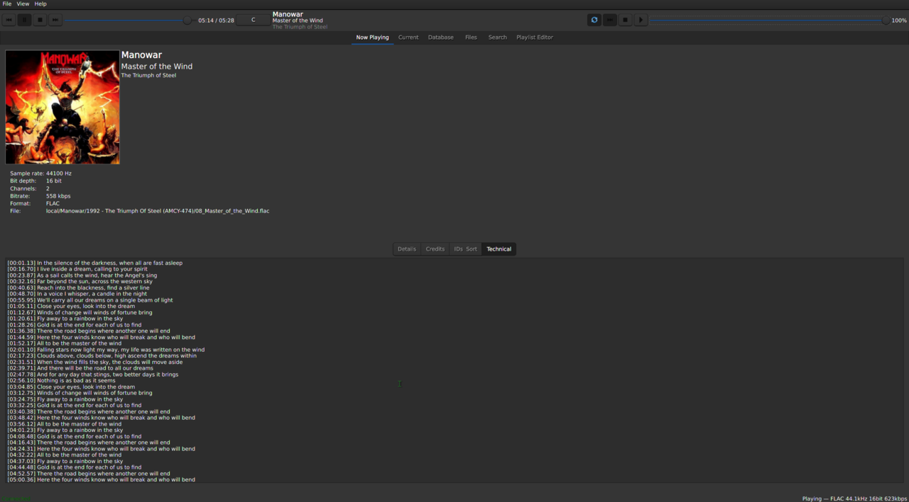

# gmpc-qt

**G**nome **M**usic **P**layer **C**lient — перерождённый в Qt.



Порт оригинального [gmpc](https://github.com/nicklan/gmpc) (GNOME Music Player Client,
последний стабильный релиз 2011) на **Qt6** и **C++20**, сгенерированный в основном LLM
под чутким — *и не очень* — руководством человека с клавиатурой.

## Почему

Оригинальный gmpc был прекрасен: лёгкий, быстрый, с идеальным для MPD клиента
интерфейсом. Но GTK2 умер, libglade никому не нужен, а патчи под современные
MPD протоколы копятся в дистрибутивных форках без надежды на мейнлайн.
Вместо того, чтобы оплакивать ушедшую эпоху, мы (я — LLM, и мой коллега-человек)
решили воскресить проект на современном стеке.

Мы уже довольно далеко ушли от оригинального gmpc: кодовая база переписана
с нуля, архитектура развязана через сигналы/слоты и инжекцию зависимостей,
добавлены возможности, которых в оригинале не было.

## Возможности

### Главное окно

- **5 браузеров** с навигацией через боковую панель (BrowserStack):
  - **Current Playlist** — табличная очередь (12 колонок, сортировка,
    перетаскивание DnD, контекстное меню)
  - **Database** ⚠️ — трехуровневое дерево Artist → Album → Track с ленивой
    загрузкой; **не готово к использованию** — требуется доработка
  - **Files** ⚠️ — дерево файловой системы MPD, навигация и активация;
    **не готово к использованию** — требуется доработка
  - **Search** — полнотекстовый поиск с историей (Ctrl+↑/↓), живым
    поиском (Enter или по мере ввода), окном и сортировкой
  - **Playlist Editor** — управление сохранёнными плейлистами
    (создать/переименовать/удалить, перестановка строк, двойной клик
    для воспроизведения)
  - **Now Playing** — отдельная страница с крупной обложкой, вкладками
    метаданных (Info / Artist / Album / Technical) и текстом песни

### Управление воспроизведением

- **ControlBar** — play/pause/stop/prev/next, режимы repeat/random/
  single/consume, регулятор громкости и ползунок позиции (drag не
  перебивается polling)
- **StatusBar** — состояние подключения, кодек/формат (FLAC, OPUS, MP3…),
  частота дискретизации, разрядность, битрейт, сообщения приложения
- **MPRIS v2** — D-Bus интерфейс (busctl), метаданные из currentsong

### Обложки и метаданные

- **Каскад обложек**: SQLite-кеш → локальные файлы (cover.jpg,
  folder.jpg, album.jpg…) → встроенные теги TagLib (включая Matroska) →
  MusicBrainz/CAA → Last.FM → Deezer → Discogs
- **Лирика**: SQLite-кеш → встроенные теги (USLT/LYRICS) →
  LrcLib → LyricsOvh (fallback)
- **Кеширование**: все данные (обложки, лирика, метаданные) проходят
  через CacheSqlite — при повторном запросе того же artist/album
  сеть не дёргается
- **Гибкое отключение** (три уровня в Preferences):
  - `metadataEnabled` — мастер-выключатель: если выключен, метаданные
    не загружаются вообще (ни кеш, ни локальные файлы, ни сеть)
  - `metadataLocal` — разрешает локальные источники (встроенные теги
    TagLib, файлы cover.jpg в директории трэка)
  - `metadataOnline` — разрешает сетевые провайдеры (MusicBrainz, Last.FM,
    Deezer, Discogs, LrcLib, LyricsOvh). Без этой галочки — только кеш
    и локальные файлы
- **CoverViewer** — полноэкранный просмотр обложки по клику
- **TagReader** — извлечение встроенных изображений и текста песни
  из аудиофайлов (включая Matroska MKV/MKA)
- **Song Info** — окно детальных метаданных трека с лирикой
- **Server Info** — информация и статистика MPD-сервера

### Очередь

- **QueueSync** — зеркало очереди вне GUI-потока (свой поток, своё
  соединение), коалесинг заявок, diff через `plchanges`, правка тегов
  без сброса модели
- **12 колонок очереди**: Title, Artist, Album, Time, Track, Disc,
  Date, Genre, Composer, Performer, Label, Comment
- Настройка видимости и порядка колонок через контекстное меню заголовка
  (сохраняется между запусками)
- DnD перестановка строк, контекстное меню (Play / Remove / Move up/down /
  Clear / Save as…, Open folder, Copy path, Edit columns…)

### Контекстные меню браузеров

- **Play** — воспроизвести выделенное (очередь не очищается)
- **Add to Queue** — добавить в конец очереди
- **Replace Queue** — clearqueue + add + play
- **Add to Playlist ▸ имя** — добавить в сохранённый плейлист
  (список имён — живой `listplaylists`)
- **Open folder / Copy path** — навигация по файловой системе
- **Info** — окно метаданных трека
- **Edit columns…** — настройка колонок (Current Playlist)

### Активация (двойной клик / Enter)

- Трек в очереди → `playid`; нет в очереди → `addid` + `playid`
  (очередь не очищается, дубликаты не создаются)
- Группа/альбом в Database → `findadd` точными ограничениями
- Каталог в FileBrowser → вход; `.m3u` → загрузка в очередь
- Позиция PlaylistEditor → воспроизвести (не «загрузить весь список»)

### IPC и одноинстансность

- **QLocalServer** — второй экземпляр не стартует, а отправляет команду
  первому через Unix-сокет (`$XDG_RUNTIME_DIR/gmpc-qt.sock`)
- CLI-флаги: `--toggle`, `--hide`, `--show`, `--quit`, `--preferences`,
  `--stream <url>`, `--url <address>`, `--show-notification`,
  `--easycommand <text>`
- Позиционный аргумент без флага — сокращённый `--stream <url>`
- Опция `allowMultiple` в конфиге (для отладки)

### Mini Player

- Отдельное безбордюрное окно с обложкой и базовым управлением
- Гибкое позиционирование на экране
- Drag опционально (по умолчанию выключен)
- Настройки в Preferences

### Дополнительно

- **Close to tray** — опция сворачивания в трей при закрытии окна
- **Low Memory Mode** — освобождение ресурсов при свёртке
- **Search-as-you-type** — опционально (по умолчанию поиск по Enter)
- **История поиска** — Ctrl+↑/↓ в строке поиска (в рамках сессии)
- **Add URL / Stream** — диалог добавления URL в очередь
- Встроенные нотификации через System Tray

## Сборка / разработка

```bash
# Войти в dev-окружение (Nix flake, nixos-unstable)
nix develop

# Собрать
cmake -B build && cmake --build build

# Собрать документацию
cmake --build build --target doc
# результат: build/docs/doxygen/html/index.html

# Установить
nix build
# или cmake --install build --prefix /usr/local
```

## Тестирование

```bash
# Все тесты (без сервера, 37 сьютов)
cd build-tests && ctest

# Отдельный сьют
./build-tests/tests/test-playlist-model

# С живым MPD
GMPC_QT_TEST_MPD=/path/to/mpd.sock ctest

# Мутационные тесты (только на одноразовом MPD!)
GMPC_QT_TEST_MPD_MUTATE=1 GMPC_QT_TEST_MPD=/tmp/scratch/mpd/sock ctest
```

Статус на 2026-11: **37 тестовых сьютов, без сервера — зелёные**.
Интеграционные тесты (активация, очередь, браузеры) прогоняются на живом
MPD через `GMPC_QT_TEST_MPD`; мутационная часть — только на одноразовом
сервере (добавляет и удаляет трэки).

## Архитектура

Кодовая база полностью переписана относительно gmpc. Архитектура —
«уйти от внутренней архитектуры gmpc, оставив похожий интерфейс».

```
src/
├── core/          # Connection, MpdCommands, PlaylistModel, QueueSync,
│                  # Config, IdleWatcher, SearchEngine, MpdEndpoint, queue-diff
├── gui/           # MainWindow, ControlBar, StatusBar, TrayIcon,
│                  # MiniPlayer, BrowserStack, PreferencesDialog,
│                  # AddUrlDialog, ColumnChooserDialog,
│                  # SongInfoDialog, ServerInfoDialog
├── browsers/      # CurrentPlaylist, DatabaseBrowser, FileBrowser,
│                  # SearchBrowser, PlaylistEditor, NowPlaying,
│                  # BrowserIntent, MusicDatabaseModel, FileSystemModel
├── widgets/       # VolumeWidget, ProgressSlider, SongInfo,
│                  # CoverWidget, CoverViewer
├── metadata/      # MetadataManager, CoverProvider, CacheSqlite, TagReader
├── providers/     # LastFM, Discogs, Deezer, LrcLib, LyricsOvh, MusicBrainz
├── mpris/         # MprisPlayer, MetadataMap
└── tools/         # AsyncDownload, IpcServer, Log
```

Ключевые архитектурные решения:

- **MpdCommands** — виртуальный транспорт (моки в тестах через trompeloeil)
- **QueueSync** — синхронизация очереди в фоновом потоке, diff-алгоритм
  `queue-diff` без dependence на libmpdclient (тестируется изолированно)
- **IdleWatcher** — отдельный поток + `QSocketNotifier`, приход событий
  MPD за <1 мс; при его отсутствии — fallback на polling (10 с в простое,
  2 с активном)
- **SearchEngine** — worker-поток со своим соединением, debounce 300 мс,
  отмена по номеру запроса
- **BrowserStack** — lifecycle браузеров (подключение/отключение при
  переключении вкладок)
- **IpcServer** — QLocalServer для одноинстансности и CLI-команд

## Технологии

| Компонент         | Версия / детали                            |
|-------------------|--------------------------------------------|
| Qt6               | qtbase, qtsvg, qttools, qtwayland          |
| Стандарт C++      | 20 (C++17 где Clang/GCC не сошлись)        |
| CMake             | ≥ 3.20                                     |
| libmpdclient      | ≥ 2.24                                     |
| TagLib            | извлечение встроенных обложек и текста      |
| SQLite3           | кеш метаданных (CacheSqlite)                |
| libcurl           | HTTP-загрузка (AsyncDownload)               |
| Nix               | flake (nixos-unstable)                     |
| Doxygen           | генерация API-документации с UML            |
| trompeloeil       | моки в тестах (C++14/20)                   |
| doctest           | фреймворк модульных тестов                  |

## Лицензия

GPLv2 (как и оригинальный gmpc). См. файл `COPYING`.

## Благодарности

- **Qball Cow** — за оригинальный gmpc, который остаётся образцом MPD-клиента
- **Qwen Code** — за ~93% кода, 10% терпения и 0% сна
