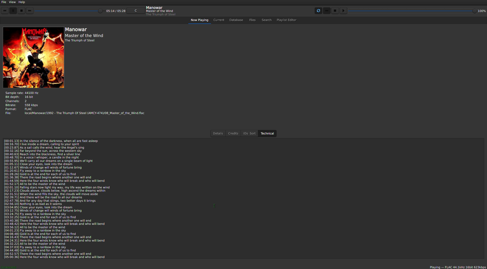

# gmpc-qt

**G**nome **M**usic **P**layer **C**lient —— 重生在 Qt 之上。



[gmpc](https://github.com/nicklan/gmpc)（GNOME Music Player Client，最后一个稳定版发布于 2011 年）的 **Qt6** 和 **C++20** 移植版本。代码大部分由 LLM 生成，在键盘前的人类（不总是）敏锐的指导下完成。

## 为什么会有这个项目

原版 gmpc 堪称完美：轻量、快速、拥有完美的 MPD 客户端界面。但 GTK2 已死，libglade 无人问津，针对现代 MPD 协议的补丁在各发行版的分支中积压，无望合并回主线。与其哀叹逝去的时代，我们（我和我的 LLM 同事）决定在现代技术栈上复活这个项目。

我们已经远远超越了原始的 gmpc：代码库完全重写，架构通过信号/槽和依赖注入解耦，增加了许多原版没有的功能。

## 功能特性

### 主窗口

- **5 个浏览器**，通过侧边栏导航（BrowserStack）：
  - **当前播放列表** — 表格形式队列（12 列，排序，拖拽 DnD，右键菜单）
  - **音乐数据库** — 主从视图资料库：左边按任意标签分组（艺术家/风格/年份…）显示群组与专辑，含服务器端曲目计数与时长，延迟加载专辑，名称过滤；右边始终显示选中节点的歌曲表，配有封面、统计信息、过滤器和可自定义列
  - **文件浏览** — MPD 文件系统的双面板浏览器：左侧为目录树，
    含虚拟根节点「/」和递归过滤器；右侧显示选中目录的内容，
    支持名称过滤（回车或实时可选）并保持浏览根不因输入而重置。
    两面板列宽均可配置，右侧列宽持久化保存。导航与右键菜单
    （播放/添加/替换/打开文件夹…）在两侧面板皆可工作
  - **搜索** — 全文搜索，带历史记录（Ctrl+↑/↓），实时搜索（回车或随输入即时搜索），结果窗口与排序
  - **播放列表编辑** — 管理已保存的播放列表（新建/重命名/删除，拖拽排序，双击播放）
  - **正在播放** — 独立页面，大尺寸封面，元数据标签页（信息/艺术家/专辑/技术信息）和歌词

### 播放控制

- **ControlBar** — 播放/暂停/停止/上一首/下一首，重复/随机/单曲/消费模式，音量滑块，进度条（拖拽不受轮询影响）
- **StatusBar** — 连接状态，编解码器/格式（FLAC、OPUS、MP3…），采样率，位深度，比特率，应用消息
- **MPRIS v2** — D-Bus 接口（busctl），源自 currentsong 的元数据

### 封面与元数据

- **级联封面获取**：SQLite 缓存 → 本地文件（cover.jpg、folder.jpg、album.jpg…）→ TagLib 内嵌标签（含 Matroska）→ MusicBrainz/CAA → Last.FM → Deezer → Discogs
- **歌词**：SQLite 缓存 → 内嵌标签（USLT/LYRICS）→ LrcLib → LyricsOvh（后备）
- **缓存**：所有数据（封面、歌词、元数据）都经过 CacheSqlite —— 重复请求相同 artist/album 时不再发起网络调用
- **灵活开关**（偏好设置中的三级控制）：
  - `metadataEnabled` — 总开关：关闭则完全不加载元数据（无缓存、本地文件、网络）
  - `metadataLocal` — 允许本地来源（TagLib 内嵌标签、曲目目录中的 cover.jpg 等）
  - `metadataOnline` — 允许网络来源（MusicBrainz、Last.FM、Deezer、Discogs、LrcLib、LyricsOvh）。不勾选则仅使用缓存和本地文件
- **CoverViewer** — 点击封面进入全屏查看
- **TagReader** — 从音频文件中提取内嵌图片和歌词（含 Matroska MKV/MKA）
- **Track Info** — 选中曲目的详细元数据窗口，含封面、标签页（详情/制作/ID与排序/技术信息）和歌词 — 与 Now Playing 页面相同的视觉体验
- **Server Info** — MPD 服务器信息与统计

### 队列

- **QueueSync** — GUI 线程外独立的队列镜像（独立线程、独立连接），请求合并，通过 `plchanges` 做差异同步，标签编辑不重置模型
- **12 列队列**：标题、艺术家、专辑、时长、音轨、光盘、日期、流派、作曲、演奏者、厂牌、注释
- 通过表头右键菜单自定义列的可见性和顺序（设置跨启动持久保存）
- 拖拽重排行，右键菜单（播放/移除/上移/下移/清空/另存为…/打开文件夹/复制路径/编辑列…）

### 浏览器右键菜单

- **Play** — 播放选中项（不清空队列）
- **Add to Queue** — 添加到队列末尾
- **Replace Queue** — clearqueue + add + play
- **Add to Playlist ▸ 名称** — 添加到已保存的播放列表（名称列表实时取自 `listplaylists`）
- **Open folder / Copy path** — 文件系统导航
- **Info** — 曲目元数据窗口
- **Edit columns…** — 列设置（当前播放列表）

### 激活（双击 / Enter）

- 队列中的音轨 → `playid`；不在队列中 → `addid` + `playid`（不清空队列，不创建重复项）
- Database 中的分组/专辑 → 精确条件 `findadd`
- FileBrowser 中的目录 → 进入；`.m3u` → 加载到队列
- PlaylistEditor 中的位置 → 播放该位置（而非「加载整个列表」）

### IPC 与单实例

- **QLocalServer** — 第二个实例不会启动，而是通过 Unix 套接字向第一个实例发送命令（`$XDG_RUNTIME_DIR/gmpc-qt.sock`）
- CLI 参数：`--toggle`、`--hide`、`--show`、`--quit`、`--preferences`、`--stream <url>`、`--url <address>`、`--show-notification`、`--easycommand <text>`
- 无标志的位置参数是 `--stream <url>` 的简写
- 配置中的 `allowMultiple` 选项（用于调试）

### 迷你播放器

- 独立无边框窗口，显示封面和基本控制
- 灵活屏幕定位
- 可选拖拽（默认关闭）
- 在偏好设置中配置

### 其他

- **关闭到托盘** — 关闭窗口时折叠到系统托盘的选项
- **低内存模式** — 窗口最小化时释放资源
- **边输入边搜索** — 可选（默认回车搜索）。支持队列、搜索、
  文件浏览器和音乐资料库
- **搜索历史** — Ctrl+↑/↓ 在搜索框中（会话内）
- **添加 URL / 流** — 添加 URL 到队列的对话框
- 通过系统托盘的内置通知

## 构建 / 开发

```bash
# 进入开发环境（Nix flake, nixos-unstable）
nix develop

# 构建
cmake -B build && cmake --build build

# 构建文档
cmake --build build --target doc
# 结果：build/docs/doxygen/html/index.html

# 安装
nix build
# 或 cmake --install build --prefix /usr/local
```

## 测试

```bash
# 全部测试（无需服务器，37 个套件）
cd build-tests && ctest

# 单个套件
./build-tests/tests/test-playlist-model

# 使用真实 MPD
GMPC_QT_TEST_MPD=/path/to/mpd.sock ctest

# 变异测试（仅在一次性 MPD 上！）
GMPC_QT_TEST_MPD_MUTATE=1 GMPC_QT_TEST_MPD=/tmp/scratch/mpd/sock ctest
```

2026-11 状态：**37 个测试套件，无需服务器 —— 全部通过**。
集成测试（激活、队列、浏览器）在真实 MPD 上通过 `GMPC_QT_TEST_MPD` 运行；变异部分仅在一次性服务器上执行（会添加和删除曲目）。

## 架构

代码库相对于 gmpc 完全重写。架构原则：「摆脱 gmpc 内部架构，保留相似的界面」。

```
src/
├── core/          # Connection, MpdCommands, PlaylistModel, QueueSync,
│                  # Config, IdleWatcher, SearchEngine, MpdEndpoint, queue-diff
├── gui/           # MainWindow, ControlBar, StatusBar, TrayIcon,
│                  # MiniPlayer, BrowserStack, PreferencesDialog,
│                  # AddUrlDialog, ColumnChooserDialog,
│                  # SongInfoDialog, TrackInfoWindow,
│                  # ServerInfoDialog
├── browsers/      # CurrentPlaylist, DatabaseBrowser, FileBrowser,
│                  # SearchBrowser, PlaylistEditor, NowPlaying,
│                  # BrowserIntent, MusicDatabaseModel, FileSystemModel
├── widgets/       # VolumeWidget, ProgressSlider, SongInfo,
│                  # CoverWidget, CoverViewer,
│                  # TrackInfoPanel
├── metadata/      # MetadataManager, CoverProvider, CacheSqlite, TagReader
├── providers/     # LastFM, Discogs, Deezer, LrcLib, LyricsOvh, MusicBrainz
├── mpris/         # MprisPlayer, MetadataMap
└── tools/         # AsyncDownload, IpcServer, Log
```

关键架构决策：

- **MpdCommands** — 虚拟传输层（测试中通过 trompeloeil 使用 mock）
- **QueueSync** — 后台线程中的队列同步，`queue-diff` 差异算法不依赖 libmpdclient（可独立测试）
- **IdleWatcher** — 独立线程 + `QSocketNotifier`，MPD 事件到达时间 <1 毫秒；不可用时回退到轮询（空闲 10 秒，活跃 2 秒）
- **SearchEngine** — 工作线程 + 独立连接，防抖 300 毫秒，按请求号取消
- **BrowserStack** — 浏览器生命周期管理（切换标签时连接/断开）
- **IpcServer** — QLocalServer 实现单实例和 CLI 命令

## 技术栈

| 组件              | 版本 / 详情                              |
|-------------------|------------------------------------------|
| Qt6               | qtbase, qtsvg, qttools, qtwayland        |
| C++ 标准          | 20（Clang/GCC 未达成共识处使用 C++17）   |
| CMake             | ≥ 3.20                                   |
| libmpdclient      | ≥ 2.24                                   |
| TagLib            | 提取内嵌封面和歌词                       |
| SQLite3           | 元数据缓存（CacheSqlite）                |
| libcurl           | HTTP 下载（AsyncDownload）               |
| Nix               | flake (nixos-unstable)                   |
| Doxygen           | 生成带 UML 的 API 文档                   |
| trompeloeil       | 测试中的 mock 框架（C++14/20）           |
| doctest           | 单元测试框架                             |

## 许可证

GPLv2（与原始 gmpc 相同）。参见 `COPYING` 文件。

## 致谢

- **Qball Cow** —— 感谢原始 gmpc，它仍然是 MPD 客户端的典范
- **Qwen Code** —— 贡献了约 93% 的代码、10% 的耐心和 0% 的睡眠
